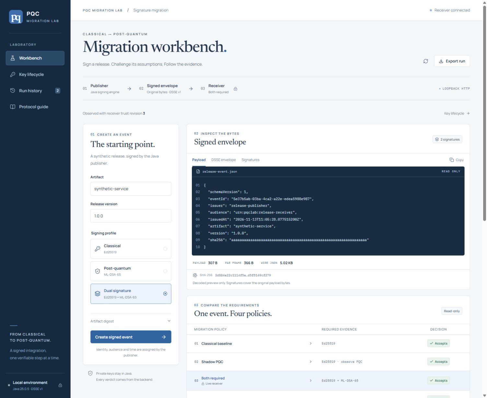
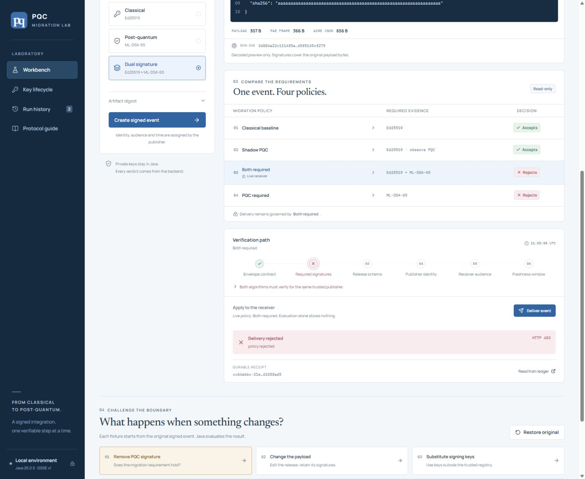
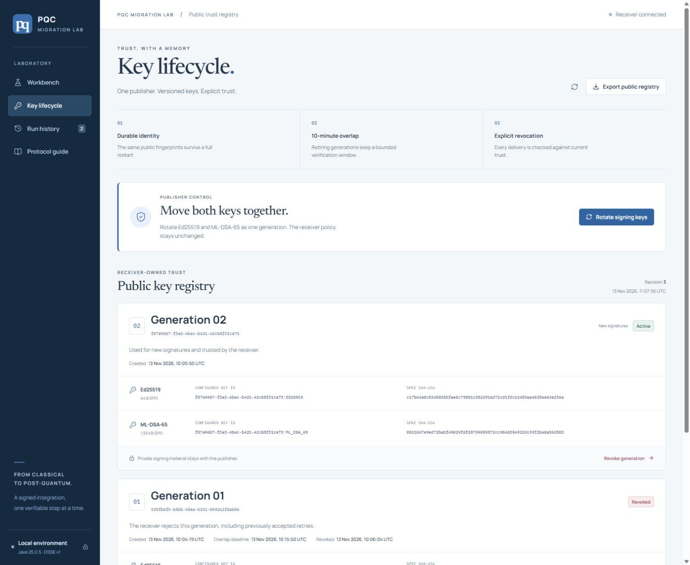
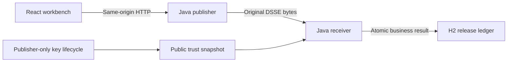

# PQC Migration Lab

[](https://github.com/gbalazsfalvi/pqc-migration-lab/actions/workflows/verify.yml)

**A working Java integration for exploring post-quantum signature migration.**

Sign a synthetic software release with Ed25519 and ML-DSA-65, follow its original bytes through DSSE and HTTP, and see how a receiver handles stronger algorithm requirements, retries, rotating keys and revoked trust.

Java owns verification and business decisions. The React workbench makes those decisions visible. Everything runs locally.

**Version 0.1.0 · Apache-2.0.** Read the [release notes](docs/releases/0.1.0.md) or download the tagged source from [GitHub Releases](https://github.com/gbalazsfalvi/pqc-migration-lab/releases/tag/v0.1.0).



_Actual local application, with synthetic data. Java 25 · Spring Boot · React / TypeScript · DSSE · JMH._

## What you can see

- **One event, four policies:** classical verification, shadow PQC, both required, and PQC required.
- **A real business boundary:** signed identity, audience and freshness checks, followed by transactional idempotency and a durable receipt.
- **Changing trust:** both signing keys rotate together; bounded overlap and persistent revocation apply to subsequent retries.
- **Evidence you can inspect:** original envelopes, precise rejection reasons, public fingerprints, reproducible reports and independent JMH measurements.

### Removing a signature changes the decision

The same payload retains a valid Ed25519 signature after its ML-DSA-65 entry is removed. The classical comparisons accept; both-required and PQC-required reject. Actual delivery under the unchanged live policy returns **HTTP 403**, while the original receipt remains available.



### Keys have a lifecycle

The receiver exposes public generation states and fingerprints. The view below shows an active generation alongside a revoked predecessor. Rotation and revocation are explicit publisher controls; historical acceptance records remain separate from current trust.



[Capture provenance and reproduction steps](docs/images/README.md). These are real local observations; fresh runs generate different event IDs, keys and timestamps.

## Try it locally

To reproduce this release from a fresh checkout:

```sh
git clone https://github.com/gbalazsfalvi/pqc-migration-lab.git
cd pqc-migration-lab
git checkout v0.1.0
```

Install **JDK 25**, **Node.js 24.14+ in the 24 LTS line**, and **npm 11**. Set `JAVA_HOME` to JDK 25. The checked-in wrapper supplies Gradle 9.2.0.

On Windows, from the repository root:

```powershell
.\lab.ps1 migration-demo
```

The launcher installs the pinned frontend dependencies when needed, starts its own isolated integration, executes the complete migration story and prints the new report directory. It restores the process's original Java setting afterwards.

On Linux or macOS, with JDK 25 selected:

```sh
npm ci --prefix workbench --no-audit --no-fund
./gradlew migrationDemo --console=plain
```

The first build downloads declared dependencies. No external database, Docker, provider account or API credential is required. Node is needed to build the UI; the packaged application needs Java at runtime.

### Open the interactive workbench

```powershell
.\lab.ps1 serve
```

Open [http://127.0.0.1:8781/](http://127.0.0.1:8781/). Spring Boot serves the finished UI and publisher API; the receiver listens on port 8782. Both servers bind to loopback. Stop them with Ctrl+C.

Create a fresh dual-signed event, compare policies, deliver it and try the fault fixtures. The Key lifecycle view manages the separate persistent interactive state. The automatic migration demo uses fresh temporary state and ephemeral ports.

The live receiver defaults to `BOTH_REQUIRED`. Changing the selected comparison in the browser does not change that requirement. Events remain subject to a five-minute freshness window.

## Reproduce the migration story

The automatic demo makes **28 real HTTP requests and 91 assertions**, including two complete shutdown/reconstruction boundaries:

| Step                             | Observed requirement                                                        |
| -------------------------------- | --------------------------------------------------------------------------- |
| Deliver a dual-signed event      | HTTP 201 and a new durable receipt                                          |
| Retry the same original bytes    | HTTP 200 and unchanged acceptance evidence                                  |
| Remove the PQC signature         | HTTP 403 under both-required, including after original acceptance           |
| Rotate both keys                 | New active generation; old public keys have ten-minute verification overlap |
| Rebuild the runtime from disk    | Public identity, revision and overlap metadata survive                      |
| Revoke the old generation        | Old retries return HTTP 403; their original receipt remains queryable       |
| Sign with the current generation | A new event receives its own receipt                                        |
| Rebuild again                    | Revocation persists and the current event reuses its receipt                |

Each invocation writes `report.md`, `report.json`, exact reviewed public HTTP bodies and `SHA256SUMS` under `build/reports/migration-demo/run-<uuid>/`. PASS requires all phases, assertions and cleanup to complete. Failed and incomplete runs return a nonzero exit and retain honest partial evidence.

The live policy stays both-required throughout this story. Read-only four-policy comparisons are recorded separately. See [the walkthrough](docs/walkthrough.md) and [demo contract](docs/milestone-05a.md).

## Engineering decisions



Two isolated Boot contexts run in **one JVM** with real loopback HTTP. The receiver receives independently imported public verification capabilities; private signing capabilities stay on the publisher side.

| Boundary                   | Responsibility                                                              |
| -------------------------- | --------------------------------------------------------------------------- |
| `lab-core`                 | Dependency-free protocol model, DSSE framing and signing/verification ports |
| `crypto-jca` / `dsse-json` | Explicit provider and wire adapters                                         |
| `integration-core`         | Framework-free policy, signed claims, current trust and ledger ports        |
| `integration-app`          | Boot composition, HTTP/JDBC adapters, local key vault and demonstrations    |
| `technical-probe`          | JDK/Bouncy Castle interoperability and public reference-vector checks       |
| `benchmarks`               | Forked JMH experiments, exact sizes and versioned evidence                  |
| `workbench`                | React/TypeScript presentation of actual Java observations                   |

Important decisions are enforced by code and architecture tests:

- Verify the **original payload bytes**, rather than reserializing a decoded preview.
- Treat wire key IDs as unauthenticated hints; use receiver-owned trust and policy.
- Verify every retry against current requirements before consulting idempotency.
- Hold the public-trust lease through durable reception so revocation cannot complete between verification and commit.
- Capture both active signing ports together; persist lifecycle changes before publishing them.
- Keep read-only comparison separate from business writes.

Read [ADR 0001](docs/decisions/0001-signed-migration-laboratory.md) for alternatives and consequences.

## Validation and measurements

The latest local verification on **13 November 2026** passed:

| Evidence                             | Result                                       |
| ------------------------------------ | -------------------------------------------- |
| Java tests                           | 210 passed; zero failed or skipped           |
| Frontend tests                       | 17 passed                                    |
| Cryptographic interoperability probe | 53 checks passed                             |
| Four-policy HTTP demonstration       | 23 expectations passed                       |
| Migration story                      | 91 assertions over 28 HTTP requests          |
| Forked JMH smoke matrix              | 21 cases completed; functional harness check |

Strict compilation, Javadoc, formatting, TypeScript, architecture rules, dependency checksums and per-module 90% line-coverage gates remain enabled. [The publication review](docs/publication-review.md) records the scope, dependency findings and remaining release decisions.

The [GitHub Actions workflow](.github/workflows/verify.yml) runs the quality gates and synthetic demonstrations on Windows and Linux for each push and pull request. The dated local verification above was performed on Windows; consult the actual workflow results for remote execution evidence.

### Run the checks

```powershell
.\lab.ps1 verify
.\lab.ps1 probe
.\lab.ps1 demo
.\lab.ps1 migration-demo
.\gradlew.bat benchmarkSmoke
```

### Measure cryptographic operations

```powershell
.\lab.ps1 benchmark -BenchmarkProfile standard
```

The standard profile covers 57 cases with independent JVM forks, warm-up, samples and uncertainty. A complete run takes at least 15 minutes of timed iterations, plus setup. Run it on an otherwise quiet machine.

Each run writes readable and structured reports plus raw JMH evidence under `build/reports/benchmarks/`. Smoke results and functional HTTP timings are not comparative performance evidence. Read [the measurement method](docs/milestone-04a.md) before interpreting results.

## Security and scope

This is a **local synthetic reference project**. It demonstrates application-level signature migration, not post-quantum TLS, a production KMS or production operator authentication. The OS account, JVM, providers and trusted clock are part of its boundary.

Managed integration keys persist in an authenticated encrypted publisher vault with a separate owner-only account secret. Probe and benchmark keys remain ephemeral. Runtime material and private encodings are excluded from reports and Git.

Use [SECURITY.md](SECURITY.md), [the threat model](docs/threat-model.md) and [the key lifecycle contract](docs/milestone-04b.md) for supported assumptions, recovery and limitations. Published reference vectors do not confer FIPS validation or NIST approval.

## Documentation and project status

- [Guided walkthrough](docs/walkthrough.md)
- [Protocol and byte contract](docs/dsse-profile.md)
- [Integration and policy API](docs/milestone-02.md)
- [Workbench behaviour](docs/milestone-03.md)
- [Key storage, rotation and revocation](docs/milestone-04b.md)
- [One-command demo and public evidence](docs/milestone-05a.md)
- [Benchmark method](docs/milestone-04a.md)
- [Publication review and open decisions](docs/publication-review.md)
- [Bilingual portfolio case study](docs/portfolio-case-study.md)
- [Version 0.1.0 release notes](docs/releases/0.1.0.md)
- [Roadmap](docs/roadmap.md)
- [Contributor operating guide](AGENTS.md)

The bilingual portfolio case study is implemented and checked in the separate Astro portfolio. Version 0.1.0 is the first tagged reference release. The application runs locally; hosted operation and a demonstration video are separate future work.

## License

Copyright 2026 Gergő Balázsfalvi.

Project-authored code, documentation and original application screenshots are licensed under the **Apache License, Version 2.0**. See [LICENSE](LICENSE) for the full terms and [NOTICE](NOTICE) for attribution.

Third-party dependencies, public reference fixtures, fonts and Gradle wrapper files retain their applicable upstream terms. Their provenance and retained notices are described in [THIRD_PARTY_NOTICES.md](THIRD_PARTY_NOTICES.md); the project licence does not replace those terms.
