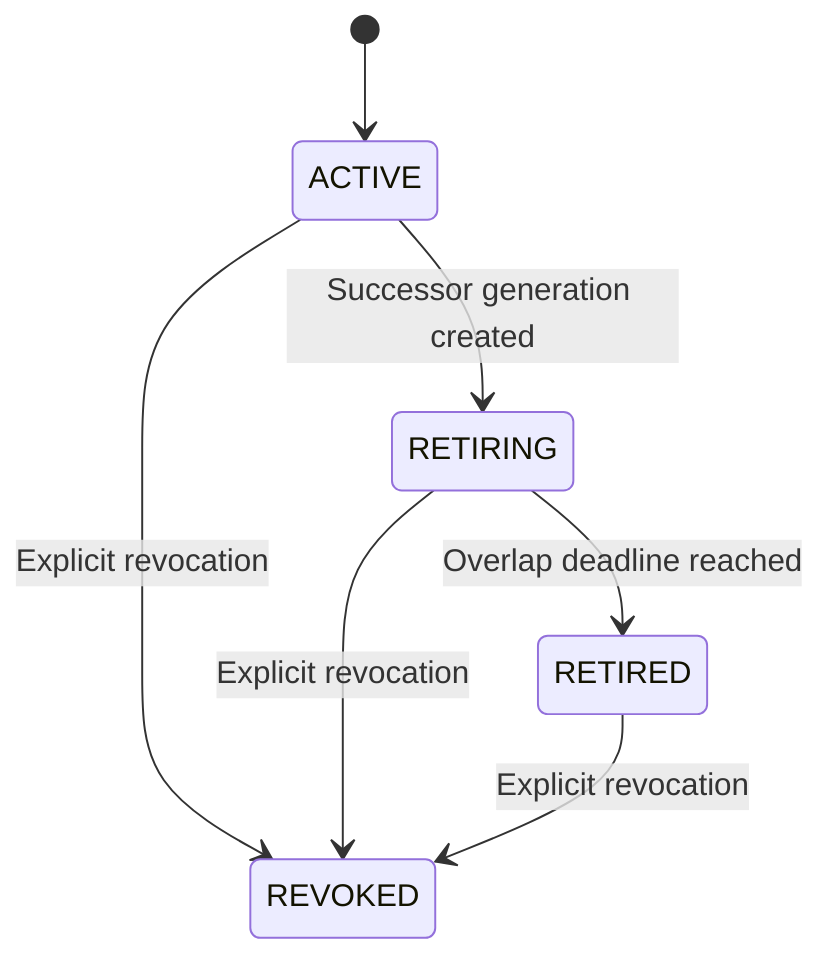

# Milestone 04B — Durable key lifecycle

The local integration now preserves signing identity across complete restarts and supports rotation and revocation without weakening receiver policy. The publisher owns private capabilities; the receiver receives independently imported public verifiers and public metadata only. Both Boot contexts still run in one local JVM.

## Run locally

```powershell
.\lab.ps1 serve
```

Open [the workbench](http://127.0.0.1:8781/) and select **Key lifecycle**. The first managed launch initializes protected storage. Subsequent launches load the same authenticated active generation.

The cryptographic probe, JMH benchmarks and deterministic legacy integration fixtures remain ephemeral. They report no managed lifecycle controls.

## Storage and account boundary

| Location | Content |
| --- | --- |
| `<data-dir>/keys/vault.pqckey` | Authenticated encrypted publisher key state |
| `<data-dir>/keys/vault.lock` | Exclusive process-lifetime writer lock |
| `<data-dir>/keys/vault.initialized` | Protected initialization marker that distinguishes prior managed state from first use |
| Windows: `%LOCALAPPDATA%/PqcMigrationLab/key-secrets/<namespace>.key` | Separate owner-only random 256-bit wrapping secret |
| Other supported hosts: `~/.local/share/pqc-migration-lab/key-secrets/<namespace>.key` | Equivalent account-scoped wrapping secret |

The namespace is derived from the canonical data-directory path. It is not a password. A trusted local `PQC_LAB_KEY_SECRET_FILE` environment variable may select an existing account-secret location. That file must be outside the integration data directory and accessible only to its owner. No HTTP request can select a path, unlock value, issuer or key encoding.

The encrypted format is `PQCLKEY1`, a fresh 96-bit nonce, and AES-256-GCM ciphertext with a 128-bit authentication tag. JCA performs all cryptography. The format identifier and configured issuer are authenticated as additional data; the entire versioned state, public/private bindings, revision and lifecycle metadata are encrypted and authenticated together.

The wrapping secret is generated with the platform secure random source. POSIX files are created with owner-only permissions; Windows files are created atomically with owner-only ACLs. Existing broader access, symbolic-link files, unsupported protection models, malformed sizes and missing vault/secret halves are rejected. Once the initialization marker exists, losing both halves is also a startup failure. A complete authenticated pair can finish an interrupted initial marker write without replacing keys.

Every load validates strict bounded JSON, algorithm coverage, unique ordered generations, unique public fingerprints and corresponding active public/private pairs. Only the current unrevoked generation retains PKCS#8 private encodings. Rotation and revocation remove obsolete private material from the next stored state; previous public identities remain available for verification history.

Updates write encrypted bytes to a protected temporary file, flush them, and require an atomic replacement in the same directory. An unsupported or failed atomic replacement returns an operational failure while the old live snapshot remains selected. There is no non-atomic fallback. Another process cannot open the same managed vault concurrently.

## Lifecycle semantics

Each generation contains one Ed25519 key and one ML-DSA-65 key. Rotation creates a complete new pair and switches new signing atomically. A signing operation captures both ports together, so a concurrent rotation cannot mix generations in one new dual signature.



- **ACTIVE:** selected for new signing and eligible for verification.
- **RETIRING:** public verification remains eligible until the exclusive overlap deadline.
- **RETIRED:** the overlap ended; the public key is no longer eligible.
- **REVOKED:** explicitly excluded from verification regardless of overlap or receipt history.

The overlap is fixed at 600 seconds. Key eligibility is captured once when a receiver operation acquires its public trust snapshot; an operation already admitted before a deadline may finish afterwards. The overlap never extends the separate five-minute signed-event freshness limit.

Revocation has no reactivation endpoint. Revoking the selected active generation pauses new signing with `SIGNING_KEYS_REVOKED` until a recovery rotation creates a fresh generation. Revoked public history remains visible. The local registry has a hard limit of 16 generations, bounding storage and verification work; reaching it returns `KEY_GENERATION_LIMIT` without pruning history or changing policy.

Ed25519 and ML-DSA evidence must still belong to the same configured publisher and exact payload. During overlap, eligible generations of that owner remain valid. A wire `keyid` is an unauthenticated hint and cannot turn a revoked key into a trusted one.

## Revocation and durable delivery

The public trust port holds an operation-scoped read lease through signature verification, business-claim validation and ledger application. A lifecycle writer acquires the corresponding exclusive lease. It prepares public and private snapshots, persists authenticated state, then publishes both under that lease.

Consequently, a revocation waits for an already-verified commit before it completes. Every later receiver operation uses the new trust revision. There is no gap where a request can verify under old trust, wait for revocation to finish, then commit using that old authorization.

The receiver object graph contains public keys and the coordination lock, with no publisher manager, signer, private-key loader or wrapping secret. Architecture tests enforce that receiver/trust code cannot depend on publisher key management or private-key types.

Every retry is reverified before durable idempotency. A revoked signature is rejected even when its event already has a receipt. The original receipt remains queryable, retaining its original acceptance time and evidence. Newly valid signatures over the same original payload may reuse its receipt if current policy, identity, audience and freshness all pass.

The local revision monotonically increases on successful changes. Control requests carry the exact revision the operator reviewed. Concurrent or stale operations receive `KEY_REVISION_CONFLICT` rather than silently creating another generation or overwriting a newer decision.

## Local API

| Endpoint | Behaviour |
| --- | --- |
| `GET :8782/api/receiver/keys` | Receiver-owned public revision, generation states, identifiers and SPKI fingerprints |
| `GET :8781/api/workbench/keys` | Fixed gateway to the actual receiver public directory |
| `POST :8781/api/workbench/keys/rotate` | Durable complete-generation rotation |
| `POST :8781/api/workbench/keys/revoke` | Durable irreversible generation revocation |

Rotation request:

```json
{ "expectedRevision": 1 }
```

Revocation request:

```json
{
  "expectedRevision": 2,
  "generationId": "328fb6f3-b5bb-45ee-b231-859212f8ab56"
}
```

The identifier above is an illustrative UUID; use an actual configured generation from the public directory. The request cannot choose overlap duration, receiver policy, file paths, algorithms or new key material. Unknown fields, duplicate keys, scalar coercion, malformed UUIDs and invalid counters are rejected.

Malformed controls return 400, unknown generations 404, revision/capacity/unmanaged conflicts 409, and storage or blocked-signing failures 503. Exact origin, Host, loopback binding, content-type, bounded body and no-cache protections remain in force. The receiver exposes no lifecycle write route.

Comparison responses include `trustRevision`. Signature observations and all four policy decisions use the same held public snapshot.

## Workbench

The Key lifecycle view reads actual receiver metadata, polls read-only state, presents both full SPKI fingerprints and exports public metadata only. A native dialog explains revocation consequences before the control request. The active-generation dialog also explains that signing will pause.

After a key change, the workbench re-evaluates the current event and its original baseline using Java. A previous delivery outcome is cleared from the current observation; its durable receipt remains separately available. Retrying a lost mutation response is preceded by a fresh public read; the browser never automatically repeats a rotation.

Page reload clears session event history, as before. It does not remove durable key identity, revocation history or release receipts.

## Operational boundaries

- This is a local synthetic laboratory with one JVM and two isolated Boot contexts. It does not provide public operator authentication, hardware key isolation, KMS integration, certificate distribution or post-quantum TLS.
- The OS account and trusted clock are part of the boundary. A process running as that account, an administrator, or a restored older filesystem backup is not prevented from replacing the complete local state. GCM detects tampering, not authorized whole-vault rollback; there is no external anti-rollback authority.
- Removing obsolete private encodings is not a secure-erasure guarantee for heap memory, filesystem snapshots or old backups.
- File flushing and atomic replacement do not claim stronger power-loss durability than the host filesystem provides. An interrupted initial creation that leaves only one vault/secret half fails closed and needs deliberate recovery.
- Back up the encrypted vault and its separately protected account secret together. Restoring the vault without its original secret fails. Moving a data directory changes its default account-secret namespace; an explicit trusted secret-file path can identify the original secret.
- The first upgrade from the earlier ephemeral runtime creates a new managed identity. Already-discarded pre-upgrade private keys cannot be recovered; existing ledger receipts are preserved.
- Stop a serving process before overwriting its runnable JAR, or run an immutable copy outside build outputs during development.

## Verification

Tests use real native JCA keys, protected files, authenticated encryption, actual loopback HTTP and file-backed H2. They cover:

- Stable fingerprints and signing capability across disk-only runtime reconstruction.
- Rotation overlap and exact retirement boundary.
- Persistent revocation, active-signing failure and recovery rotation.
- Rejected revoked retries with unchanged historical receipts.
- Unsigned policy/key-hint substitutions and exact origin rejection.
- Concurrent signing snapshots, revision conflicts and verification/commit versus revocation ordering.
- Failed durable writes retaining the previous live state.
- Missing files, wrong account secrets, owner binding, ciphertext tampering, malformed schemas and broader file permissions.
- Public-only API serialization, architecture rules, frontend wire contracts, native dialog behaviour and responsive layout.

The existing strict compilation, Javadoc, formatting, TypeScript and per-module coverage gates remain enabled. Probe and HTTP demo expectations remain unchanged.

Primary implementation references: [JCA authenticated encryption](https://docs.oracle.com/en/java/javase/25/docs/api/java.base/javax/crypto/Cipher.html), [NIO file operations](https://docs.oracle.com/en/java/javase/25/docs/api/java.base/java/nio/file/Files.html), and [ACL creation attributes](https://docs.oracle.com/en/java/javase/25/docs/api/java.base/java/nio/file/attribute/AclFileAttributeView.html).
