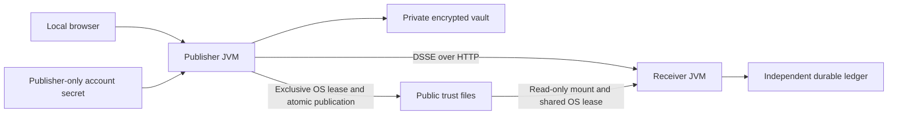

# Milestone 06A: separate service processes

This milestone runs the publisher and receiver in independent JVMs or separate local
Docker Compose containers. The original one-JVM 05A demonstration remains available
for comparison. This is a local reference deployment, not a production hosting setup.

## Run the complete story

On Windows, using the repository launcher:

```powershell
.\lab.ps1 migration-demo
.\lab.ps1 compose-demo
```

The first command uses native child JVMs. The second builds the current source into
a pinned local image, creates a uniquely named Compose project, runs the same HTTP
story, and removes that project's containers, network and volumes when finished.
Neither command attaches to an existing workbench.

The native demo requires JDK 25 and the pinned Node/npm build prerequisites. The
Compose demo additionally requires a running **local** Docker engine. SSH and TCP
Docker contexts are rejected. Docker Desktop's local named-pipe endpoint and Linux
Unix-socket engines are supported.

On Linux/macOS, install the pinned workbench dependencies first:

```sh
npm ci --prefix workbench --no-audit --no-fund
./gradlew migrationDemo --console=plain
./gradlew composeMigrationDemo --console=plain
```

Reports are written to new run directories beneath:

- `build/reports/migration-demo/`: default native 06A story.
- `build/reports/process-migration-demo/`: explicit `:integration-app:processMigrationDemo`.
- `build/reports/compose-migration-demo/`: real separate-container story.
- `build/reports/migration-demo-05a/`: retained `:integration-app:legacyMigrationDemo`.

A completed 06A run currently contains **108 assertions and 32 scenario HTTP
requests**. Readiness probes and Docker control commands are not counted as
scenario HTTP observations. Every reported HTTP exchange uses actual Java services;
there are no browser-generated signature verdicts. Failure retains honest partial
evidence and returns a nonzero exit. Raw Docker diagnostics remain private under
`.local/compose-demo/`, separate from the shareable JSON/Markdown/checksum bundle.

## Start the interactive Compose deployment

From a fresh source checkout, Docker alone can build and start the workbench:

```sh
docker compose up --build --detach --wait
```

Open <http://127.0.0.1:8781/>. The receiver is published only on
<http://127.0.0.1:8782/>. Both host publications bind to IPv4 loopback.

The Windows launcher supports explicit alternative ports, for example while the
legacy workbench is already running:

```powershell
.\lab.ps1 compose-up -PublisherPort 8791 -ReceiverPort 8792
.\lab.ps1 compose-down
```

On other shells, set `PQC_LAB_PUBLISHER_PORT` and `PQC_LAB_RECEIVER_PORT` before
running Compose. A normal `docker compose down` retains the interactive named
volumes. Do not add `--volumes` unless you intentionally want to remove that
interactive deployment's persistent keys and receipts.

The automated demonstration uses a different, generated `pqc06a-...` project name
and its own ports and volumes. Its final volume cleanup cannot select the ordinary
interactive project.

## Native services without containers

Initialize once, then run receiver and publisher in separate terminals:

```powershell
.\lab.ps1 init
.\lab.ps1 receiver
.\lab.ps1 publisher
```

Each service has one Boot context and one HTTP listener. Stop each foreground
launcher with Ctrl+C. Native persistent state is separated into
`.local/services/publisher/`, `.local/services/receiver/` and
`.local/services/public-trust/`. The wrapping secret remains outside publisher
data, using the existing account-scoped secret location.

The packaged executable also accepts strict role settings:

```sh
java -jar integration-app/build/libs/integration-app-0.2.0.jar --role=init
java -jar integration-app/build/libs/integration-app-0.2.0.jar --role=receiver
java -jar integration-app/build/libs/integration-app-0.2.0.jar --role=publisher
```

The packaged executable's `--help` lists both legacy and single-role options.
Arbitrary Spring command-line overrides and caller-supplied
remote receiver URLs are not accepted by the service launcher.

## Ownership and storage



| Responsibility | Publisher | Receiver |
| --- | --- | --- |
| Signing and lifecycle controls | Yes | No |
| Private vault and wrapping secret | Mounted | Not mounted |
| Public SPKI and lifecycle history | Writer | Read-only reader |
| Business ledger | Not mounted | Independent writable volume |
| Container user | UID/GID 10001 | UID/GID 10002 |
| Root filesystem | Read-only | Read-only |
| Host HTTP publication | IPv4 loopback | IPv4 loopback |

The initializer owns the publisher volumes and exports public state before either
HTTP service starts. Both services depend on its successful completion. Each has
a healthcheck that reads current public trust without depending on the other
service. Compose's startup conditions are documented in the
[Docker startup-order reference](https://docs.docker.com/compose/how-tos/startup-order/).

The services use a dedicated Compose bridge. Host HTTP publications bind only to
IPv4 loopback; this is not an outbound firewall or a production network boundary.
Containers drop Linux
capabilities, use no-new-privileges, bounded memory/PIDs and a temporary /tmp.
The receiver's read-only public volume uses public-readable files but grants
no writer capability. It receives neither the publisher's vault volume nor its
wrapping-secret volume. See Docker's
[volume isolation and read-only mount reference](https://docs.docker.com/engine/storage/volumes/).

The reference image disables positive, negative and stale JVM DNS caching for its
fixed local service names. This lets the surviving publisher resolve a recreated
receiver's new container IP on the next explicit delivery attempt. The additional
security-properties file preserves the JRE's standard provider configuration; it
does not replace the system security file. This is scoped to the local reference
image and its trusted Docker DNS, not general advice for untrusted remote DNS.
See the [JDK address-cache properties](https://docs.oracle.com/en/java/javase/25/docs/api/java.base/java/net/doc-files/net-properties.html).

## Trust publication and revocation ordering

Private-key encodings remain inside the authenticated publisher vault. The public
projection contains only strict lifecycle metadata and canonical public SPKI bytes.
The receiver independently imports public verifier capabilities; it does not
deserialize publisher managers, signers or private-key loaders.

The stable `trust.lock` inode coordinates JVMs and containers:

1. A receiver acquires a shared OS lease, loads the current strict public snapshot,
   verifies signatures and claims, and keeps the lease through durable application.
2. A lifecycle writer acquires the exclusive lease before changing durable state.
3. It flushes a pending marker before private persistence.
4. It persists the authenticated private state and atomically publishes the
   corresponding public revision.
5. Only complete publication removes the pending marker and allows success.

A failed or interrupted publication leaves trust unavailable. The publisher also
stops new signing after a failed public commit. Restarting the publisher/init role
authenticates the private vault and reconciles public state under the exclusive
lease. A receiver never creates, repairs or rewrites trust. Missing established
files, malformed metadata, changed same-revision lineage, unsupported private-key
fields and revision rollback fail closed.

NIO lock acquisition has a bounded deadline. Contention produces an unavailable
response rather than bypassing the trust boundary. Filesystem locks and atomic
rename must be supported; this design is for the local filesystem/Compose named
volumes, not a remote trust-distribution protocol.

## Expanded recovery evidence

The original acceptance, four-policy comparisons, downgrade rejection, rotation,
overlap, revocation and historical-receipt assertions run across three complete
runtime phases. The first phase additionally proves:

- Publisher and receiver have distinct actual JVM/container identities. Raw IDs
  are not copied into the public evidence.
- Abrupt receiver termination produces HTTP 503 through the surviving publisher
  gateway, with a safe `RECEIVER_UNAVAILABLE` connection/DNS failure or bounded
  `DELIVERY_TIMEOUT` response. The actual code remains visible in the HTTP artifact;
  policy, trust-store and unrelated internal errors do not satisfy this check.
- Restarting only the receiver preserves the publisher instance, trust and every
  original receipt field.
- The receiver continues to verify an exact retry while the publisher is stopped.
- Restarting only the publisher preserves the receiver instance and the persisted
  signing identity; the exact retry remains `ALREADY_ACCEPTED`.

Native fault injection forcibly terminates the owned receiver. Compose uses
SIGKILL on that project's receiver container. The scenario never targets a
caller-selected PID, project, remote host or interactive workbench.

The independent-process trial exposed H2's default delayed log flush: a recently
acknowledged receipt could be lost on immediate termination. Both launch modes now
set `WRITE_DELAY=0`, requiring commit log flush before returning success. The
[H2 setting reference](https://h2database.com/html/commands.html#set_write_delay)
describes the default delay and URL setting. This removes application-level delayed
flush; durability still depends on the underlying OS/filesystem/hardware guarantees.

## Verification and scope

The ordinary quality gates retain strict compilation, Javadoc, formatting,
architecture checks and the **90% per-module line-coverage gate**. Unit tests cover
public trust validation, crash fencing, recovery, operation leases, strict launch
settings, real role startup, command deadlines and owned Compose cleanup. The
complete native process story also runs as a JUnit integration regression without
requiring Docker in the unit environment.

The real Compose task remains a separate explicit verification command. Its
orchestration tests use a controlled Docker command boundary only; they never
replace cryptographic or HTTP verdicts. Run the actual Compose demonstration to
verify the container deployment.

The report's Java/OS fields describe its executing driver. Native children use
that JDK; container service runtimes are pinned by the Dockerfile manifests.
Functional HTTP timings and startup durations are not comparative JMH measurements.

This milestone assumes the local OS account, Docker engine, source checkout,
clock and providers are trusted. It does not add production operator authentication,
remote trust distribution, post-quantum TLS, FIPS validation or hosted deployment.
The retained 05A command and the published v0.1.0 tag remain available as the
original one-JVM reference.

## Initial local verification record

Verified on **16 November 2026**, using Windows 11, Temurin JDK 25.0.5 and a local
Docker Desktop Linux engine. No remote CI run, publication or hosted deployment
was performed at this initial milestone checkpoint. The implementation is
included in [version 0.2.0](releases/0.2.0.md); release CI is tracked separately.

| Evidence | Observed result |
| --- | --- |
| Java tests | 222 passed; zero failures, errors or skipped tests |
| Frontend tests | 17 passed |
| Protocol interoperability probe | 53 passed |
| Original policy HTTP demo | 23 passed |
| Native launcher `lab.ps1 migration-demo` | PASS; 108 assertions / 32 scenario HTTP requests |
| Actual Compose migration story | PASS; 108 assertions / 32 scenario HTTP requests |
| Per-module line coverage | All seven modules above the unchanged 90% gate; integration-app 92.98% |
| Browser delivery on published port 8791 | Original event HTTP 201; unsigned downgrade HTTP 403 |
| Actual receiver container | UID 10002, read-only root and public trust, writable receiver ledger, no publisher-private mount |

The combined Java/formatting/Javadoc/architecture/coverage, archive, probe and
container demonstration command was:

```powershell
.\gradlew.bat spotlessApply check assemble probe :integration-app:demo composeMigrationDemo --max-workers=2 --dependency-verification=strict --console=plain
```

The native launcher was additionally executed as documented. Each demonstration
wrote its own public JSON/Markdown/body artifacts and checksum manifest. Raw
process/container diagnostics stayed outside those public bundles. The separate
benchmark implementation was unchanged; no new comparative timing claim is made.
