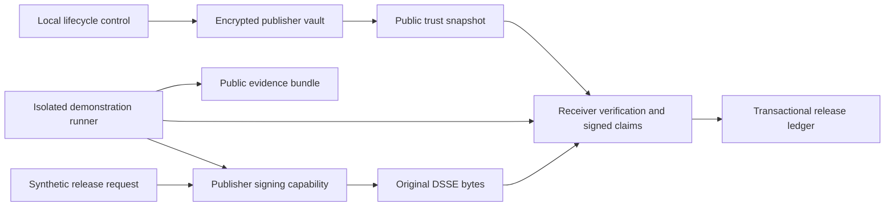

# Threat model · Local signed migration laboratory

## Scope and trust assumptions

This model covers the current local integration and milestone-05A evidence runner. It describes implemented controls and explicit limits, rather than certifying a production system.

The OS account, JVM, native cryptographic providers, installed dependencies and UTC clock are trusted. Private signing and verification capabilities are separated within one process; they are not isolated from a hostile process owner. The public receiver registry is initialized by trusted local startup.

Assets are the publisher's active signing capability, the receiver's current verification requirements, original authenticated payload bytes, issuer-scoped event identity, durable acceptance evidence and the accuracy of exported observations.

## Trust boundaries

The diagram shows logical dependencies. HTTP requests cross actual loopback listeners, while trust publication and lease coordination remain inside one JVM. The receiver is never supplied a private-key loader or signing port.

## Threats and implemented controls

| Threat | Implemented control | Evidence and limits |
| --- | --- | --- |
| Payload modification or ambiguous envelope interpretation | Verify DSSE framing over original bytes; bounded strict parsing; application-specific payload contract | Interoperability/protocol tests and payload-change fixtures; no custom cryptographic mathematics |
| Signature stripping or unsigned policy override | Receiver-owned algorithm policy; both-required means both algorithms for one configured owner and payload | Policy tests, HTTP attack demo and 05A stripped-delivery rejection |
| Replacing a wire key ID to impersonate an owner | IDs are hints; verification uses the configured public directory | Key-substitution and hint-tampering tests; no discovery from arbitrary sender URLs |
| Wrong owner, audience or signed time | Validate authenticated issuer, audience and freshness | Core and HTTP tests; clock correctness is a trust assumption |
| Exact replay causing duplicate business effects | Atomically reserve issuer/event ID and apply one result in the same database transaction | Original replay and unchanged receipts; conflicting signed bytes under an existing ID are rejected |
| Previously accepted replay bypassing changed trust | Verify current policy and trust before reading the durable idempotency result | 05A revoked retries fail while historical receipts remain queryable |
| Revocation racing an already verified commit | Hold a public-trust read lease through verification, claims and ledger commit; lifecycle writes take the exclusive lease | Concurrency tests; applies within this JVM, not a distributed consensus protocol |
| Partial dual-key rotation or failed durable lifecycle write | Capture both signing ports once; persist authenticated new state before exposing it under the write lease | Concurrent signing, persistence-failure and restart tests |
| Missing or modified local key material | AES-256-GCM authentication, owner-only files, process lock, initialization marker and fail-closed loading | Storage/tamper tests; no fallback key regeneration for damaged managed state |
| Browser-origin abuse or DNS rebinding against local controls | Loopback binding, host validation, exact origin checks, cross-site rejection and restrictive headers | Local guard tests; a non-browser process already running as the OS user is trusted |
| Evidence runner mutating the interactive sandbox | New temporary workspace, explicit independent secret, fixed ephemeral loopback listeners | Three-phase integration test and cleanup checks; no existing endpoint argument |
| Secret leakage into evidence | Only synthetic requests and reviewed public response fields are copied; no runtime-tree collection, headers or exception messages | Nested-field export refusal and artifact tests; this is an explicit export contract, not a general-purpose secret detector |
| Unexpected outcomes being presented as success | Independently specified assertions, fail-fast dependent actions, PASS/FAIL/INCOMPLETE and nonzero failure exit | Real HTTP negative tests, semantic mismatch and interrupted execution tests |
| Changed evidence artifacts | Per-body digests and a manifest covering both reports and referenced bodies | Byte-consistency tests; the unsigned manifest supplies no independent authenticity |

## Important exclusions

- No protection against an administrator, hostile same-account process, compromised JVM/provider/dependency or malicious source checkout.
- No external anti-rollback authority. Restoring an older complete vault and its secret can restore older trust; authenticated encryption alone does not prevent that.
- No hardware key isolation, managed KMS, certificate hierarchy, remote key discovery or multi-node trust distribution.
- No post-quantum TLS, confidentiality of synthetic HTTP payloads, internet-facing authentication or public-service availability claim.
- No proof that application composition or a provider is certified merely because an algorithm is standardized.
- No secure-erasure guarantee for memory, filesystem history or backups; abrupt termination can leave synthetic temporary runtime material.
- No cryptographic provenance for generated reports. Someone controlling an entire unsigned bundle can replace its reports and checksums.
- No performance conclusion from HTTP story execution. Separate JMH evidence is interpreted under its own warm-up, forks, samples and uncertainty.

Public deployment would require a separate threat model and controls for operator access, process/network boundaries, key custody, recovery, monitoring and resource budgets.

## Standards and interpretation

The [DSSE protocol](https://github.com/dsse-lf/dsse/blob/master/protocol.md) defines authenticated payload framing and unauthenticated key hints. This application adds its own policy, claim and transaction rules.

[NIST FIPS 204](https://csrc.nist.gov/pubs/fips/204/final) specifies ML-DSA. The laboratory uses platform implementations; algorithm selection alone does not establish end-to-end system security or implementation certification.

Read the executable boundaries in [the operating guide](../AGENTS.md), [key lifecycle contract](milestone-04b.md), [05A contract](milestone-05a.md) and [architecture decision](decisions/0001-signed-migration-laboratory.md).
