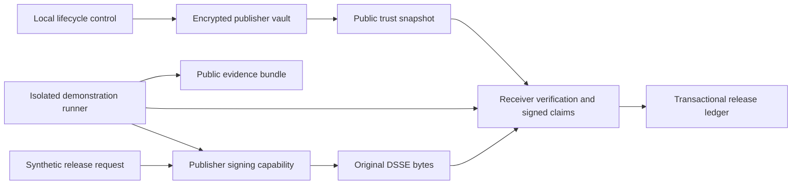

# Threat model · Local signed migration laboratory

## Scope and trust assumptions

This model covers the local integration, the retained milestone-05A runner, the separate-process/native and Compose 06A deployment and the four-phase 06B rehearsal. It describes implemented controls and explicit limits, rather than certifying a production system.

The OS account, JVM, native cryptographic providers, installed dependencies and UTC clock are trusted. The 06A Compose deployment also trusts the local Docker engine and its DNS. Native services run in separate JVMs under the local account. Compose additionally uses distinct non-root users and mounts only public trust and the receiver's own ledger into the receiver. These controls do not protect against a hostile host administrator or Docker operator. Trusted initialization authenticates the publisher vault and exports public trust before services start.

Assets are the publisher's active signing capability, the receiver's current verification requirements, original authenticated payload bytes, issuer-scoped event identity, durable acceptance evidence and the accuracy of exported observations.

## Trust boundaries

The diagram shows logical dependencies. Native requests cross loopback listeners; Compose uses fixed service DNS internally and IPv4 loopback host publications. The 06A receiver reads a strict public snapshot and holds a shared OS file lease through durable reception. The publisher holds the exclusive lease across private/public publication, with a flushed pending fence on partial failure. The receiver is never supplied a private-key loader or signing port. The retained 05A runtime coordinates equivalent public capabilities within one JVM. See the [06A contract](milestone-06a.md) for ownership and recovery details.

## Threats and implemented controls

| Threat | Implemented control | Evidence and limits |
| --- | --- | --- |
| Payload modification or ambiguous envelope interpretation | Verify DSSE framing over original bytes; bounded strict parsing; application-specific payload contract | Interoperability/protocol tests and payload-change fixtures; no custom cryptographic mathematics |
| Signature stripping or unsigned policy override | Receiver-owned algorithm policy; both-required means both algorithms for one configured owner and payload | Policy tests, HTTP attack demo and 05A stripped-delivery rejection |
| Replacing a wire key ID to impersonate an owner | IDs are hints; verification uses the configured public directory | Key-substitution and hint-tampering tests; no discovery from arbitrary sender URLs |
| Wrong owner, audience or signed time | Validate authenticated issuer, audience and freshness | Core and HTTP tests; clock correctness is a trust assumption |
| Exact replay causing duplicate business effects | Atomically reserve issuer/event ID and apply one result in the same database transaction | Original replay and unchanged receipts; conflicting signed bytes under an existing ID are rejected |
| Previously accepted replay bypassing changed trust | Verify current policy and trust before reading the durable idempotency result | 05A revoked retries fail while historical receipts remain queryable |
| Original acceptance being misrepresented after a policy deployment | Preserve acceptedPolicy, acceptedAt and original signature evidence; expose current enforcedPolicy separately | Actual 06B deployments reject earlier classical retries under PQC requirements while historical reads remain unchanged |
| A sender or demo controller silently changing the rollout requirement | Receiver startup configuration only; the owned rehearsal control permits exactly the next reviewed deployment step | Reversed, skipped and repeated-step tests, unsigned-override rejection and real observed policy configuration in each phase |
| Revocation racing an already verified commit | Hold a public-trust read lease through verification, claims and ledger commit; lifecycle writes take the exclusive lease | Concurrency tests and the 06A stable-inode OS lease; requires working local filesystem locking, not distributed consensus |
| Partial dual-key rotation or failed durable lifecycle write | Capture both signing ports once; persist authenticated new state before exposing it under the write lease | Concurrent signing, persistence-failure and restart tests |
| Missing or modified local key material | AES-256-GCM authentication, owner-only files, process lock, initialization marker and fail-closed loading | Storage/tamper tests; no fallback key regeneration for damaged managed state |
| Partial private/public trust publication | Flush a pending fence before private persistence; publish an atomic public projection under the exclusive lease; fail closed until authenticated recovery | Public-store corruption, publication failure and recovery tests; receiver cannot create or repair trust |
| Receiver compromise reaching signing files | Separate container UID, receiver-only ledger and read-only public trust mount; no publisher state, secret or Docker socket mount | Actual Compose mount/user inspection; the local host and Docker operator remain trusted |
| Acknowledged result disappearing after receiver termination | H2 `WRITE_DELAY=0`, transactional receipt and idempotency, then reverify retries against current trust | Actual native and container SIGKILL/restart stories reuse the original receipt |
| Receiver outage or changed container address | Bounded fixed-target transport errors; no local success fallback; fresh trusted Docker DNS resolution after receiver recreation | Same publisher survives receiver outage/recreation and returns the original durable receipt |
| Browser-origin abuse or DNS rebinding against local controls | IPv4 loopback host publication, fixed Host allowlists, exact origin checks, cross-site rejection and restrictive headers | Local guard tests and a real browser on an alternative published port; a same-account non-browser process is trusted |
| Evidence runner mutating the interactive sandbox | Owned temporary workspace, independent secret and ephemeral native ports or a generated Compose project with separate ports/volumes | Real three-phase stories and ownership/cleanup checks; no existing endpoint argument, no remote Docker context |
| Secret leakage into evidence | Only synthetic requests and reviewed public response fields are copied; no runtime-tree collection, headers or exception messages | Nested-field export refusal and artifact tests; this is an explicit export contract, not a general-purpose secret detector |
| Unexpected outcomes being presented as success | Independently specified assertions, fail-fast dependent actions, PASS/FAIL/INCOMPLETE and nonzero failure exit | Real HTTP negative tests, semantic mismatch and interrupted execution tests |
| Changed evidence artifacts | Per-body digests and a manifest covering both reports and referenced bodies | Byte-consistency tests; the unsigned manifest supplies no independent authenticity |

## Important exclusions

- No protection against an administrator, hostile same-account process, compromised JVM/provider/dependency or malicious source checkout.
- No external anti-rollback authority. Restoring an older complete vault and its secret can restore older trust; authenticated encryption alone does not prevent that.
- No hardware key isolation, managed KMS, certificate hierarchy, remote key discovery or multi-node trust distribution.
- No post-quantum TLS, confidentiality of synthetic HTTP payloads, internet-facing authentication or public-service availability claim.
- No proof that application composition or a provider is certified merely because an algorithm is standardized.
- No secure-erasure guarantee for memory, filesystem history or backups; abrupt termination can leave synthetic temporary runtime material.
- No cryptographic provenance for generated reports. Someone controlling an entire unsigned bundle can replace its reports and checksums.
- No performance conclusion from HTTP story execution. Separate JMH evidence is interpreted under its own warm-up, forks, samples and uncertainty.

Public deployment would require a separate threat model and controls for operator access, process/network boundaries, key custody, recovery, monitoring and resource budgets.

## Standards and interpretation

The [DSSE protocol](https://github.com/dsse-lf/dsse/blob/master/protocol.md) defines authenticated payload framing and unauthenticated key hints. This application adds its own policy, claim and transaction rules.

[NIST FIPS 204](https://csrc.nist.gov/pubs/fips/204/final) specifies ML-DSA. The laboratory uses platform implementations; algorithm selection alone does not establish end-to-end system security or implementation certification.

Read the executable boundaries in [the operating guide](../AGENTS.md), [key lifecycle contract](milestone-04b.md), [05A contract](milestone-05a.md) and [architecture decision](decisions/0001-signed-migration-laboratory.md).
